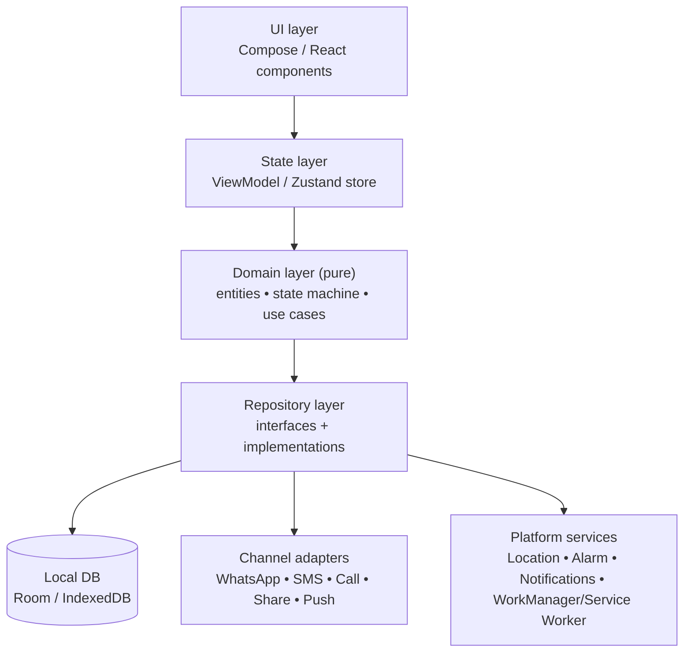
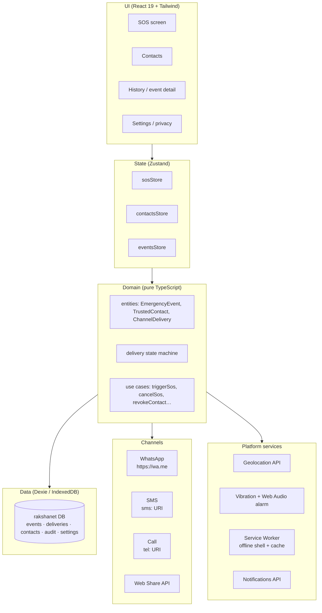
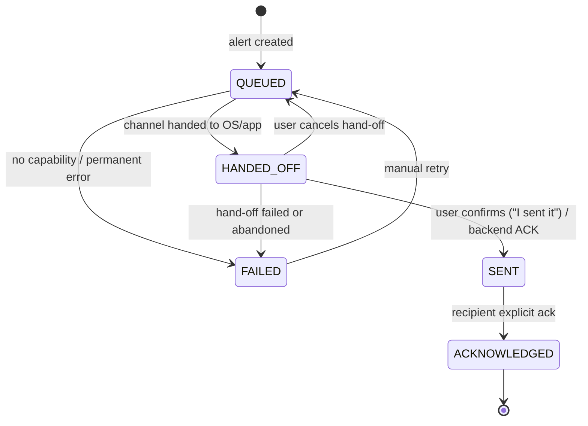
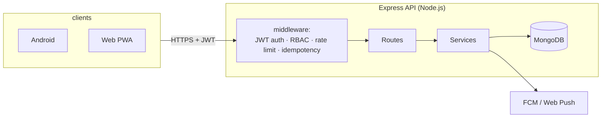

# RakshaNet — System Architecture

This document describes the architecture of the RakshaNet platform: the Android app, the
web PWA, the (future) backend, and how they share one domain model. Companion to
[PLAN.md](../PLAN.md).

---

## 1. System Context

```mermaid
C4Context
    title RakshaNet System Context

    Person(user, "Safety user", "Woman/child who triggers SOS, shares location")
    Person(guardian, "Trusted contact", "Receives alerts, can acknowledge")

    System_Boundary(rakshanet, "RakshaNet Platform")
        System(android, "Android App", "Offline-first native app (Kotlin/Compose)")
        System(web, "Web PWA", "Offline-first installable web app (React/Vite)")
        System(wear, "Wear OS app", "Watch-triggered SOS (Phase 3)")
        System(backend, "Backend API", "Node/Express + MongoDB (Phase 2)")
    end

    System_Ext(whatsapp, "WhatsApp")
    System_Ext(sms, "SMS / Carrier")
    System_Ext(geo, "Location providers")
    System_Ext(push, "FCM / Web Push")

    Rel(user, android, "triggers SOS, manages contacts")
    Rel(user, web, "triggers SOS, manages contacts")
    Rel(user, wear, "triggers SOS")
    Rel(guardian, android, "receives alerts via WhatsApp/SMS")
    Rel(guardian, web, "views alert, acknowledges")
    Rel(android, whatsapp, "share intent")
    Rel(android, sms, "send SMS")
    Rel(web, whatsapp, "wa.me hand-off")
    Rel(web, sms, "sms: hand-off")
    Rel(android, geo, "GPS/GNSS")
    Rel(web, geo, "Browser Geolocation API")
    Rel(android, backend, "sync (Phase 2)")
    Rel(web, backend, "sync (Phase 2)")
    Rel(backend, push, "notify guardians")
```

---

## 2. Architectural Principles

1. **Offline-first everywhere.** Every client performs SOS, alarm, event recording, and
   local persistence with *zero network*. Connectivity only adds channels.
2. **One shared domain contract.** Entities and the delivery state machine are defined
   once conceptually and implemented natively per platform (Kotlin / TypeScript) with the
   same rules and the same tests.
3. **Channel abstraction.** WhatsApp, SMS, call, push, and share are adapters behind a
   single `DeliveryChannel` interface. Adding a channel never touches business logic.
4. **Honest status.** The domain layer is the *only* thing allowed to advance delivery
   status, and only through legal transitions (§5). UI cannot fake a "sent".
5. **Privacy by construction.** Sharing requires an explicit contact + explicit trigger;
   revocation is immediate; nothing leaves the device without a user action or a queued,
   user-initiated alert.

---

## 3. Client Architecture (shared shape)

Both the Android app and the web PWA use the same layered shape:



Rules:
- **Domain is pure** — no I/O, fully unit-testable (this is where the delivery state
  machine lives).
- **Repositories own persistence and channel calls**; UI never talks to channels directly.
- **Platform services are injected** so tests run with fakes.

---

## 4. Web PWA Architecture

### 4.1 Why a PWA

The web app is a **full safety app**, not a companion: it must deliver the same v1
guarantees in the browser — trigger SOS, sound an alarm, capture location, persist the
event, hand off to WhatsApp/SMS, and show honest per-channel status — all while offline
after first install.

### 4.2 Layered view



### 4.3 Directory structure

```
web/
├── index.html
├── package.json / vite.config.ts / tsconfig.json
├── public/                    # static assets, icons
└── src/
    ├── main.tsx               # entry, SW registration, router mount
    ├── App.tsx                # routes + layout
    ├── styles/index.css       # Tailwind v4
    ├── domain/                # PURE: entities, state machine, use cases
    │   ├── types.ts
    │   ├── deliveryMachine.ts
    │   └── deliveryMachine.test.ts
    ├── data/                  # Dexie schema + repositories
    │   ├── db.ts
    │   ├── eventsRepo.ts
    │   ├── contactsRepo.ts
    │   └── auditRepo.ts
    ├── channels/              # DeliveryChannel adapters
    │   ├── types.ts
    │   ├── whatsapp.ts · sms.ts · call.ts · share.ts
    │   └── dispatch.ts        # fan-out + status advancement
    ├── services/              # platform wrappers (injectable/fake-able)
    │   ├── location.ts · alarm.ts · capabilities.ts
    ├── store/                 # Zustand stores
    └── features/              # sos/ contacts/ history/ settings/
        └── components/
```

### 4.4 Offline strategy

| Concern | Mechanism |
|---|---|
| App shell (JS/CSS/icons) | Service worker precache (vite-plugin-pwa, Workbox `generateSW`) — app loads with no network |
| Runtime data | IndexedDB via Dexie — events, contacts, deliveries, settings, audit |
| SOS with no network | Works fully: event + deliveries written locally first; channels attempted opportunistically |
| Unsent deliveries | Persisted as `QUEUED`; retried on next app open / connectivity (`online` event) |
| Backend sync (Phase 2) | Idempotent upload keyed by client event ID; same queue, new adapter |

**Write-ahead rule:** the event and its delivery rows are committed to IndexedDB *before*
any channel is attempted, so a crash mid-hand-off never loses the alert.

### 4.5 PWA installability

- `manifest.webmanifest`: name, icons (192/512 + maskable), `display: standalone`,
  theme colors, `start_url: "/"`.
- Service worker: `registerType: "autoUpdate"`; precached shell; navigation fallback to
  `index.html` (SPA offline routing).
- No hard dependency on push in v1 (Web Push requires a backend; Phase 2).

### 4.6 Channel capability mapping (web)

| Channel | Web mechanism | Status on hand-off | Honest limitation |
|---|---|---|---|
| WhatsApp | `https://wa.me/<phone>?text=…` | `HANDED_OFF` | User must press send; no internet ⇒ no WhatsApp |
| SMS | `sms:<phone>?body=…` (UA-aware `?`/`&`) | `HANDED_OFF` | Opens the OS messaging app; user sends |
| Call | `tel:<phone>` | `HANDED_OFF` | User completes the call |
| Share | `navigator.share({text})` | `HANDED_OFF` (abort ⇒ stays `QUEUED`) | OS share sheet; unsupported in some browsers |
| Confirm | "I sent it" button | `SENT` | Only explicit user confirmation or future backend ACK may set `SENT`/`ACKNOWLEDGED` |

The browser **cannot** observe transport confirmation, so `SENT` is user-attested on web —
which is still honest, because the UI labels it "Confirmed sent by you", not "Delivered".

---

## 5. Shared Domain Contract

### 5.1 Core entities

```
EmergencyEvent   id · type · createdAt · note? · location? · status
LocationFix      lat · lng · accuracyM · capturedAt · source
TrustedContact   id · name · phone · relation · consent · priority · channels
ChannelDelivery  id · eventId · contactId · channel · status · attempts · timestamps
AuditEntry       id · eventId? · action · at          # local audit trail
```

### 5.2 Delivery state machine (single source of truth)



**Invariants (unit-tested on every platform):**
- Only `dispatch()` may call `advance()`; UI cannot set status directly.
- Intent/share hand-off ⇒ `HANDED_OFF`, never `SENT`.
- `ACKNOWLEDGED` requires an explicit recipient action — never inferred from time.
- Illegal transitions throw / are rejected and logged.

---

## 6. Backend (Phase 2)



- **Collections:** `users`, `contacts`, `events`, `deliveries`, `audit`, `sessions` —
  mirroring the client schema; client event `_id` is the idempotency key.
- **Endpoints (planned):** `POST /auth/otp`, `GET/POST/DELETE /contacts`,
  `POST /events` (idempotent ingest), `GET /events/:id`, `POST /events/:id/ack`,
  `GET /events/:id/deliveries`.
- **Guardian ack loop:** alert link opens the web app at `/a/:eventId` (public,
  token-scoped) → guardian taps **Acknowledge** → `ACKNOWLEDGED` written back.
- **Security:** HTTPS/TLS only, JWT access + refresh rotation, per-route RBAC
  (`owner`/`guardian`/`admin`), rate limiting, no PII in logs.

---

## 7. Data Model

### 7.1 Web IndexedDB (Dexie)

```
rakshanet DB v1
├── events      PK id · idx [createdAt, status]
├── deliveries  PK id · idx [eventId, status] · idx [contactId]
├── contacts    PK id · idx [priority] · unique phone
├── audit       PK id · idx [at]
└── settings    PK key                      # profile, privacy flags, onboarding
```

### 7.2 MongoDB (Phase 2 mirror)

`users · contacts · events · deliveries · audit · sessions` — same field names as client
entities to keep sync logic mechanical.

---

## 8. Security & Privacy

- **Data at rest:** local DB holds PII — device screen lock + optional app lock (PIN/
  biometric) gate access; no PII in logs or analytics.
- **In transit:** HTTPS/TLS + certificate pinning (Android) once backend exists.
- **Secrets:** Android Keystore / Web Crypto; no secrets in localStorage.
- **Consent model:** contact consent states (`INVITED → CONSENTED → REVOKED`); revocation
  immediately cancels live sharing and blocks future sends (repository-enforced).
- **Least privilege:** location permission requested only when needed; background location
  only for time-boxed live sharing (Android) / `watchPosition` bounded by a timer (web).
- **Audit:** every send/revoke/share writes an `AuditEntry`, visible to the user.

---

## 9. Key Decisions (ADR summary)

| # | Decision | Rationale |
|---|---|---|
| 1 | PWA is a *full* safety app, not a companion | Same offline guarantees reach users without installing the Android app |
| 2 | React + Vite + Tailwind + Zustand + Dexie | Small, fast, testable; pairs with the planned Node backend |
| 3 | `wa.me` / `sms:` hand-off in v1 | Browser cannot send directly; hand-off keeps the honest-status model intact |
| 4 | `SENT` is user-attested on web | Transport confirmation is unobservable in-browser; explicit user action is honest |
| 5 | Pure domain layer + Vitest | State-machine invariants are the highest-value tests in the system |
| 6 | IndexedDB write-ahead before any hand-off | Crash-safe: alert is never lost mid-send |
| 7 | Service worker precache only (no runtime API caching in v1) | Simplicity; all data is local anyway |
| 8 | Backend deferred to Phase 2 | v1 (both platforms) works fully offline, per the product's core promise |

---

## 10. Testing Strategy

| Layer | Tool | Focus |
|---|---|---|
| Domain | Vitest (web) / JUnit (Android) | State-machine invariants, use-case rules |
| Data | Vitest + fake-indexeddb | Repository CRUD, idempotency, migrations |
| Channels | Unit tests with fake `window.open`/share | Status mapping: hand-off ≠ sent |
| UI | React Testing Library (critical paths) | SOS trigger, revoke, status display honesty |
| E2E / manual | Playwright (later) + device matrix | Airplane-mode SOS, connectivity restore, install/offline |
