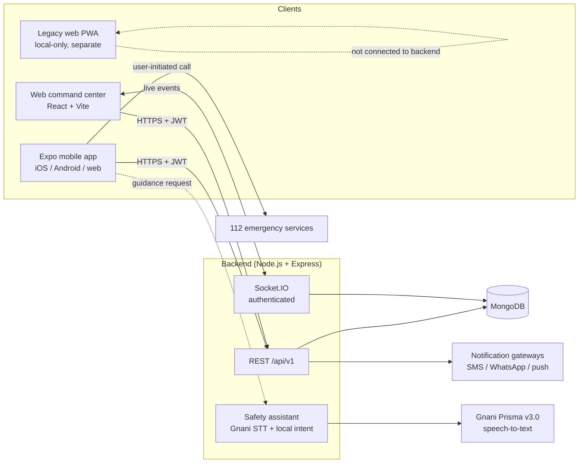
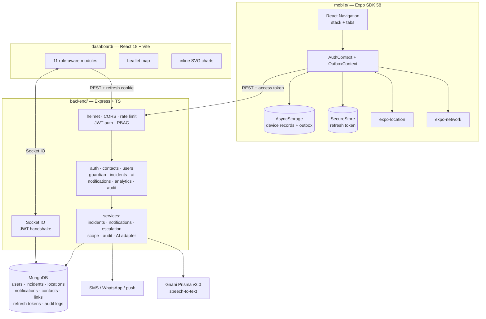
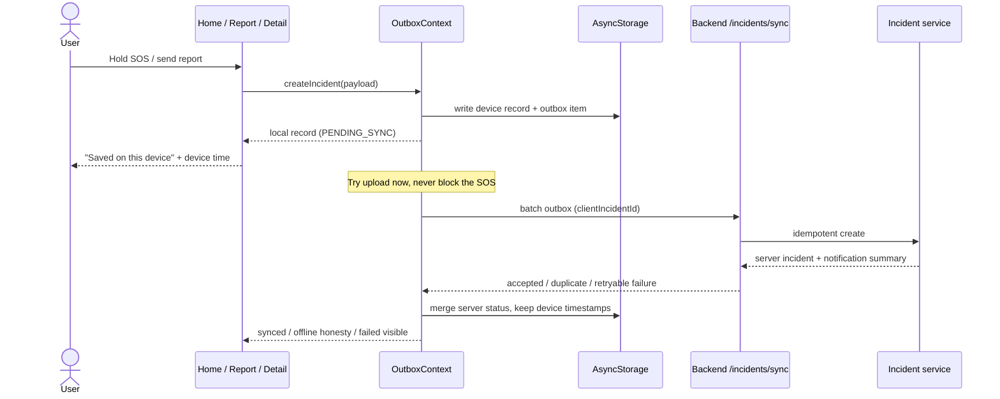
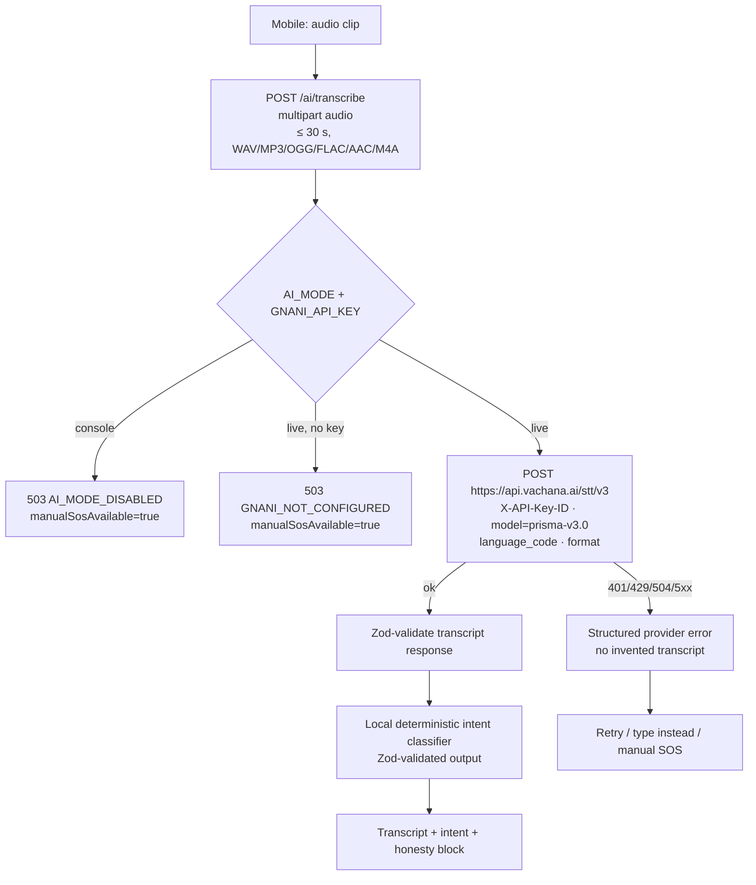

# RakshaNet / SURAKSHA AI — System Architecture

Architecture of the platform as implemented: the Express/MongoDB API, the web
command center, the Expo mobile app, the Gnani safety-guidance adapter, and the
older standalone web PWA. Companion to [PLAN.md](../PLAN.md),
[backend/README.md](../backend/README.md),
[dashboard/README.md](../dashboard/README.md), and
[mobile/README.md](../mobile/README.md).

This document describes what exists and is verified. Planned work is labelled
as such.

---

## 1. System context



Key point: **the app is not an emergency dispatch service.** It alerts the
user's own trusted contacts and guides the user; calling 112 remains an explicit
user action. The AI adapter never dispatches help.

The original `web/` PWA is a separate, local-account product from the earlier
phase. It is not connected to this backend, and its `localStorage`/IndexedDB data
does not sync with the mobile app. Do not describe the two as one integrated
client.

---

## 2. Architectural principles

1. **Offline-first for the safety action.** An SOS or report is persisted on the
   device before any network call. Connectivity adds delivery, not the ability
   to record the emergency.
2. **Honest delivery.** `SENT` means a provider accepted the message.
   `DELIVERED` requires a signature-verified provider webhook. Console-mode sends
   are always labelled `simulated`.
3. **Explicit roles, never inherited.** `USER`, `GUARDIAN`, and `ADMIN` are
   distinct. A guardian can read consented child safety data but never gains
   admin endpoints.
4. **Real data only.** The dashboard and mobile screens read backend data. There
   are no seeded fake incidents and no invented delivery counts.
5. **Confirmation before escalation.** The AI advisor can classify and guide, but
   it cannot create an incident or call emergency services on its own.
6. **Fail visibly.** Missing providers, denied location, offline gaps, and
   degraded AI are surfaced in the UI instead of being silently hidden.

---

## 3. Runtime topology



Development endpoints:

| Service | URL |
|---|---|
| Backend | `http://localhost:4000` (`/api/v1/health`) |
| Dashboard | `http://localhost:5174` |
| Expo web | `http://localhost:8081` |
| MongoDB | `mongodb://127.0.0.1:27017/suraksha_ai` |

---

## 4. Mobile app

### 4.1 Layers

| Layer | Responsibility |
|---|---|
| `src/screens` | Auth, Home, Alerts, Incident detail, Report, People, Contacts, Guardians, Settings, Safety assistant |
| `src/components` | UI primitives, hold-to-SOS button, sync banner |
| `src/context` | `AuthContext` (session + offline session), `OutboxContext` (local-first writes, sync triggers) |
| `src/offline` | Device records, outbox queues, batch sync engine, merge rules |
| `src/lib` | API + refresh rotation, location, network, storage, device metadata, formatting, confirmation |
| `src/navigation` | Typed stack and bottom tabs |
| `src/theme.ts` | Colours, spacing, typography |

The mobile client uses REST only. It does not open a Socket.IO connection; it
refreshes on screen focus, on network regain, on foreground, and on manual sync.

### 4.2 Offline outbox



Persisted state:

- `suraksha.offline-data.v1` in AsyncStorage: device incident records, pending
  incident IDs, pending location pings, pending status changes, last sync time.
- Scoped per user so one account's queue is never shown to another.
- `suraksha.refresh-token` in SecureStore (OS keychain), never in AsyncStorage.
- Capped at 100 device records; failed items remain visible until accepted or
  explicitly retried.

Sync triggers: app start, network regain (`online` event), app foreground,
manual **Sync now**, and the immediate post-create attempt. A terminated app
does not run a background task — see the limitations.

Failure policy: 4xx responses are permanent (kept with an error for the user);
network errors and 5xx are retryable. The sync engine reports each item's result
so one bad record cannot block the rest.

### 4.3 SOS flow

1. Home pre-caches a location silently (`requestPermission: false`, quick mode).
2. The hold-to-SOS button requires a 3-second hold.
3. `OutboxContext` writes the record locally with `clientIncidentId`, device
   `startedAt`, and any cached location.
4. Navigation opens the incident detail immediately. The UI says `Local only`
   and `Pending sync`.
5. The upload is attempted; on success the server records `receivedAt`, keeps
   the device time, and computes `offlineDelaySeconds`.
6. Contacts must be `VERIFIED` to receive notifications. No verified contact
   produces `DELIVERY_FAILED`, not a false "help is coming".

### 4.4 Safety assistant

The assistant supports voice and typed input.

- **Voice:** `expo-audio` records up to 30 s. Android/iOS produce M4A; web
  produces WebM, which `src/lib/voice.ts` decodes and re-encodes as mono 16 kHz
  PCM WAV because Gnani does not accept WebM. The clip is uploaded as
  multipart `audio` to `POST /api/v1/ai/transcribe`.
- **Text:** `POST /api/v1/ai/interpret` classifies typed text.

The backend sends audio to Gnani Prisma v3.0 (`POST
https://api.vachana.ai/stt/v3`, header `X-API-Key-ID`), validates the response
with Zod, then classifies the transcript locally against the fixed intent
taxonomy. The screen shows the transcript, detected language, intent, severity,
confidence, and a truthful “Gnani transcript · local intent” badge. Ambiguous
results ask for confirmation; distress is never silently discarded. Every action
(call 112, open SOS, report) stays user-confirmed. The assistant never creates an
incident, never dispatches emergency services, and manual SOS remains available
when voice fails.

---

## 5. Backend

### 5.1 Modules

| Module | Routes | Responsibility |
|---|---|---|
| Auth | `/auth` | Register/login, JWT access + rotating hashed refresh, OTP, password reset, deletion request |
| Contacts | `/contacts` | Owner-private trusted contacts, OTP verification, primary selection |
| Users | `/users` | Self profile, admin user listing/suspension |
| Guardian | `/guardian` | Consent-code links, verified child accounts, revocation |
| Incidents | `/incidents` | Create/list/detail, offline batch sync, locations, notes, lifecycle, escalation |
| Notifications | `/notifications` | Delivery feed + signed provider webhook |
| Analytics | `/analytics` | Role-scoped summary + capped CSV export |
| Audit | `/audit` | Append-only admin reader |
| Safety assistant | `/ai` | Provider status, Gnani Prisma v3.0 STT, local intent classification |

### 5.2 Auth and roles

- Passwords: bcrypt cost 12.
- Access token: short-lived JWT (`ACCESS_TOKEN_TTL`, default 15m).
- Refresh token: JWT stored **hashed** in MongoDB, rotated on every use, reuse
  detection revokes the family.
- Browser gets an `httpOnly` refresh cookie; React Native gets the refresh token
  in JSON and stores it in the device keychain.
- `USER` sees own data. `GUARDIAN` sees own data plus `VERIFIED` linked
  children. `ADMIN` sees all data, but contacts remain owner-private.
- Admin accounts are provisioned only with `npm run seed:admin`.

### 5.3 Incident lifecycle

```
CREATED -> PENDING_SYNC -> ALERTING -> NOTIFIED / DELIVERY_FAILED
              |                |
              +-> CANCELLED    +-> ACKNOWLEDGED -> RESPONDING -> RESOLVED
                               +-> ESCALATED -> ACKNOWLEDGED / RESPONDING / RESOLVED
```

- `PENDING_SYNC` is used only for a device-created record received offline. The
  server promotes it to `ALERTING` when it actually starts alerting and preserves
  the offline gap in `statusHistory` and `offlineDelaySeconds`.
- Only the owner or an admin can cancel. Only a guardian/admin can set
  `RESPONDING` or `ESCALATED`. Terminal states reject further transitions.
- Unacknowledged alerts escalate on a timer, re-alerting the primary contact.
- Location points older than the configured threshold are stored as stale and
  never replace a fresher snapshot.

### 5.4 Delivery truth

Every notification row is per recipient and per channel. In console mode the
provider is `console`, `simulated: true`, and `SENT` is recorded without any
SMTP/SMS/WhatsApp traffic. `DELIVERED` can only be written by
`POST /notifications/webhook` after an HMAC-SHA256 check of the raw body. This is
the central anti-false-claim rule of the platform.

### 5.5 Realtime

Socket.IO runs on the API origin. The handshake requires a valid access token;
anonymous sockets are rejected. Every socket joins `user:<id>`, admins also join
`admins`, and incident rooms are joined only through a server-verified
`incident:subscribe`. Sockets are disconnected when their access token expires.

---

## 6. Web command center

The dashboard authenticates with email/phone + password and keeps the access
token in memory; the refresh token is an `httpOnly` cookie. It has 11 modules:
Overview, Live Incidents, Live Map, Incident History, Users & Roles, Guardians &
Children, Trusted Contacts, Notifications, Analytics & Reports, Audit Logs, and
Settings.

Data scope follows the same backend rules as the mobile app. Admin-only pages
show an explicit access-denied state, and the API enforces the same restriction.
The map shows last-known device positions and lists incidents without GPS
separately. CSV exports are role-scoped and capped at 5,000 rows.

---

## 7. Safety assistant: Gnani STT + local intent



### Verified contract

Sources: <https://docs.gnani.ai/api/STT/speech-to-text> and
<https://docs.gnani.ai/api/STT/models/prisma-v3>.

- `POST https://api.vachana.ai/stt/v3`, `multipart/form-data`
- Auth header `X-API-Key-ID` (not `Authorization`, not `x-api-key`)
- Fields: `audio_file`, `model=prisma-v3.0`, `language_code`
  (`indic-auto`, `hi-IN`, `en-IN`, `mr-IN`, …), `format`
  (`verbatim|transcribe|codemix|transliterate`)
- Success: `{ success, request_id, transcript, model,
  detected_language_code?, processing_time?, end_to_end_latency?, truncated? }`
- Empty transcript is a valid success response and is surfaced as
  `EMPTY_TRANSCRIPT`, never as fake speech.
- Errors: `400 {success:false,error:{type,message}}`,
  `401 {detail:{error_code,message,status_code}}`, `422 {detail:[...]}`,
  `429`, `504 {code:"UPSTREAM_TIMEOUT"}`
- Audio: max 30 s, auto-converted to 16 kHz mono by Gnani.

### Local intent, not a cloud intent claim

Gnani documents speech-to-text, text-to-speech, and agent management — **no
text-intent/chat endpoint**. Intent is therefore deterministic local logic:

- Fixed taxonomy: `EMERGENCY_SOS`, `SHARE_LOCATION`, `START_JOURNEY`,
  `CHECK_IN`, `CALL_CONTACT`, `CANCEL_SOS`, `GENERAL_HELP`, `UNKNOWN`.
- Multilingual keyword scoring for Hindi, English, Marathi, and Hinglish.
- Confidence ≥ `0.75` is actionable; below that the result is `ambiguous` and
  needs confirmation; below `0.45` it is `UNKNOWN` unless distress vocabulary is
  present, which escalates to `EMERGENCY_SOS` with a confirmation prompt.
- Output is validated with Zod before serialization.
- Response labels: `provider: "local-intent"`, `mode: "local"`,
  `simulated: false` — real local logic, not a simulated cloud answer.

### Safety boundaries

- The assistant never creates an incident and never dispatches emergency
  services. Emergencies reuse the existing incident/SOS workflow after the
  user's confirmation.
- Manual SOS stays available on every error path.
- Uploaded audio is held in memory for one request and never written to disk or
  MongoDB. Audit entries (`AI_TRANSCRIBED`, `AI_INTERPRETED`) store
  provider/intent metadata, never the transcript or raw message.
- `AI_MODE=live` without `GNANI_API_KEY` refuses to boot rather than silently
  degrading.

### Verification status

The contract was checked against the official documentation and the request
format/parsing/error mapping is covered by tests. **A real provider request has
not succeeded in this environment** because `backend/.env` and `GNANI_API_KEY`
are absent. The sanitised fixtures are docs-derived (`captured_live: false`) and
are not evidence of a live call. Use `npm run gnani:smoke -- --audio <clip>` with
real credentials to complete live verification.


---

## 8. Data model (MongoDB)

| Collection | Purpose | Notable indexes / rules |
|---|---|---|
| `users` | Account, role, account type, language, verification, status | unique email/phone; explicit role enum |
| `trustedcontacts` | Owner-private contacts and channel preferences | `(userId, phone)`; OTP hash + expiry |
| `guardianlinks` | Consent-based guardian ↔ child relationship | unique active pair; `PENDING`/`VERIFIED`/`REVOKED` |
| `incidents` | SOS/report record, device + server times, lifecycle | unique `(userId, clientIncidentId)`; status history; owner summary |
| `locations` | Append-only location points | unique `(incidentId, clientLocationId)`; stale flag |
| `notifications` | Per-recipient, per-channel delivery truth | unique `idempotencyKey`; masked destination |
| `refreshtokens` | Hashed rotating refresh tokens | family/reuse detection; TTL cleanup |
| `auditlogs` | Append-only security/operations trail | no update/delete route; admin reads are audited |

Passwords, OTPs, consent codes, and refresh tokens are stored hashed. Full phone
numbers are masked in list/dashboard responses.

---

## 9. Security and privacy

- Helmet, strict CORS allow-list, per-route rate limits, 256 KB JSON limit.
- Access tokens are never persisted server-side; refresh tokens are hashed and
  rotated with reuse detection.
- The provider webhook uses HMAC-SHA256 over the exact raw body.
- Incident access is owner / verified guardian / admin only. Strangers receive
  `404` (not `403`) so incident existence is not leaked.
- Contacts are strictly owner-scoped; even admins have no write path into a
  user's private contacts.
- Location reads/writes, admin actions, CSV exports, and AI interpretations are
  audited.
- Account deletion is a **request**: sessions are revoked, the account is marked,
  and the audit trail remains. It is not an immediate hard delete.
- The mobile refresh token lives in the OS keychain; the AI API key stays
  server-side and is never returned by `/ai/status`.

---

## 10. Environment and operations

| Variable | Service | Purpose |
|---|---|---|
| `MONGODB_URI` | backend | Database |
| `JWT_ACCESS_SECRET`, `JWT_REFRESH_SECRET` | backend | Token signing |
| `CORS_ORIGINS` | backend | Dashboard + Expo web origins |
| `OTP_MODE` | backend | `console` (dev) or `provider` |
| `NOTIFICATION_MODE` | backend | `console` (labelled simulation) or `live` |
| `NOTIFICATION_WEBHOOK_SECRET` | backend | HMAC verification |
| `GNANI_API_KEY` | backend | Gnani Prisma v3.0 STT key (sent as `X-API-Key-ID`) |
| `GNANI_STT_URL` | backend | Default `https://api.vachana.ai/stt/v3` |
| `GNANI_STT_MODEL` | backend | `prisma-v3.0` (or `prisma-v2.5`) |
| `GNANI_STT_LANGUAGE` | backend | `indic-auto` or a supported language code |
| `GNANI_STT_FORMAT` | backend | `verbatim`, `transcribe`, `codemix`, `transliterate` |
| `GNANI_TIMEOUT_MS` | backend | STT request timeout (default 20 s) |
| `AI_MODE` | backend | `console` (local intent only) or `live` (Gnani STT) |
| `VITE_API_URL` | dashboard | API base |
| `EXPO_PUBLIC_API_URL` | mobile | API base |

Tests:

| Suite | Command | Current result |
|---|---|---|
| Backend | `cd backend && npm test` | 74/74 passing |
| Mobile logic | `cd mobile && npm test` | 39/39 passing |
| Typecheck | both projects | clean |
| Dashboard build | `cd dashboard && npm run build` | clean |

Tests run against a real local MongoDB test database. There is no mocked Mongo
layer, so index and query behavior is exercised for real.

---

## 11. Honest gaps

These are current limitations, not future promises:

- **Notification providers are not configured.** Delivery is console-simulated
  (`0 delivered`); no real SMS/WhatsApp/push was sent or verified.
- **A live Gnani STT request has not succeeded.** The request format, response
  parsing, error mapping, and local intent engine are tested against the
  published contract, but no `GNANI_API_KEY` was available. Fixtures are
  docs-derived (`captured_live: false`), not live captures. Run
  `npm run gnani:smoke -- --audio <clip>` with real credentials to close this.
- **Voice was not exercised end-to-end.** Recording, permission handling,
  WebM→WAV conversion, and multipart upload are implemented and unit-tested, but
  no real microphone → Gnani run happened. Native M4A recording is unverified
  without a native build. Web microphone access requires `localhost` or HTTPS.
- **Intent classification is deterministic local logic**, not an LLM. It is
  intentionally labelled `provider: "local-intent"` and `mode: "local"`; it can
  miss unusual phrasing, which is why low confidence is marked ambiguous and
  distress vocabulary forces escalation.
- **No native device verification.** The mobile app was verified on Expo web;
  iOS/Android builds, store signing, and physical-device behavior are unverified.
- **Background sync is limited.** Sync runs on start, network regain, foreground,
  and manual action. A terminated app does not run a background task.
- **No automated UI/E2E suite.** Mobile logic is unit-tested; runtime flows were
  verified manually in a browser. Backend APIs have integration tests.
- **The legacy `web/` PWA is not integrated** with the backend or the mobile app.
- **No production deployment** (TLS, managed MongoDB, secrets manager, backups,
  monitoring) is configured yet.

---

## 12. Key decisions

| # | Decision | Rationale |
|---|---|---|
| 1 | New `backend/`, `dashboard/`, `mobile/` alongside the existing `web/` | Audit and extend without destroying working work |
| 2 | Explicit `USER` / `GUARDIAN` / `ADMIN`, no inheritance | Guardian access must never become admin access |
| 3 | Device-first write-ahead outbox | SOS must survive no network and app restarts |
| 4 | `clientIncidentId` idempotency | Retries cannot duplicate alerts |
| 5 | `SENT` ≠ `DELIVERED`; webhook-only delivery | The core honesty guarantee |
| 6 | Console mode is explicit (`simulated: true`) | Avoid fake "sent" claims in development |
| 7 | AI confirms actions, never dispatches | Safety-critical actions stay human-controlled |
| 8 | Local AI fallback with `degraded: true` | A provider outage must not leave the user without guidance or hide the outage |
| 9 | Dashboard reads real backend data only | Operational trust; empty states are honest |
| 10 | Role-scoped tests against real MongoDB | Catch scope leaks and index/idempotency bugs |
